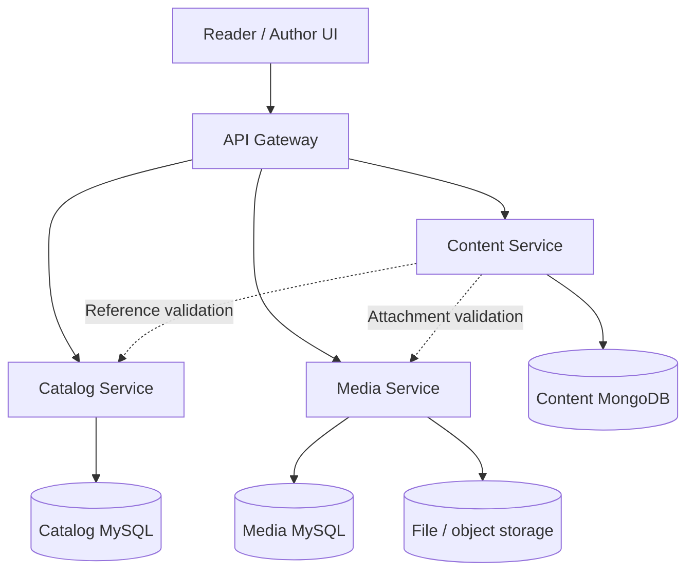

# notesAppByPower - Product and Backend Blueprint

Version 1.0 | 28 September 2026 | Design baseline for review

Technical documentation in English. User decisions are distinguished from implementation proposals.

# notesAppByPower

PRODUCT & BACKEND BLUEPRINT | Version 1.0 | 28 September 2026

A public learning library and technical blogging platform, built by two Java developers as a working product and a microservices learning project.

## Confirmed product decisions

| Area | Agreed baseline |
| --- | --- |
| Team | Two developers with 5 and 3 years of Java experience; full-time availability. No delivery deadline committed. |
| Stack | Spring Boot 3.5, MySQL, MongoDB and microservices. Java 21 and Maven are proposed defaults. |
| Audience | Anonymous readers; initially only the two authors create and manage content. |
| Content | Topic catalog, notes, blogs, drafts, attachments, publication and add/edit/update/delete operations. |
| Editor | Rich formatting, tables, code blocks, images and links; image/PDF preview within the website. |
| Delivery | Backend first; a small editor integration early, full UI later. AWS design and budget deferred. |
| Security | Login and roles introduced during the Spring Security learning phase; required before public authoring access. |

## Scope discipline

The baseline is approved at product level. Detailed schemas, endpoint names, versioning and deletion rules in this document are engineering proposals for implementation review. Work is sequenced by outcomes, not a promise to complete every infrastructure component immediately.

First release: catalog navigation, note/blog CRUD, draft saving, publication, attachments, revision safety, public reading and basic search. Future scope: review approval, reader accounts, comments, bookmarks, progress, notifications and advanced search. Live collaborative editing and a coding judge are excluded initially.

# 01 / Service ownership

| Component | Responsibility and storage | Phase |
| --- | --- | --- |
| Catalog Service | Collections, subjects, topics, ordering and archive state. Own MySQL schema/user. | First |
| Content Service | Note/blog metadata, rich body, draft/public revision pointers, interview questions. Own MongoDB database/user. | First |
| Media Service | Upload validation, file metadata and authorized preview/download. Own MySQL schema/user; local files first, private object storage later. | Editor |
| API Gateway | Route frontend requests; correlation IDs and later edge authentication/rate limits. No business database. | Integration |
| Identity / access | Authentication provider integration plus author/reviewer/admin permissions. Choose provider or implementation during Security phase. | Before public authoring |
| Reader features | Bookmarks, progress and comments if retained in future scope. Separate ownership decided then. | Deferred |
| Search capability | Initially published-content queries in Content Service; an independent index/service only when justified. | Basic first |

## Boundaries

One repository may contain independently built and deployed services. No shared entity library and no cross-service SQL joins. Services access other services through contracts, never by reading their database. Local MySQL may host separate Catalog and Media schemas with separate credentials.

## Communication proposal

Start with synchronous HTTP calls and explicit timeouts. Content validates catalog references and media readiness when needed. Public content reads do not require a live Catalog call. Background cleanup is retryable. Add broker/outbox patterns when a concrete asynchronous use case is implemented; Kafka, Redis, Kubernetes and service discovery are not initial requirements.

## Dependency topology

The diagram on the next page shows request routes and data ownership. Optional/future components are separated from the initial implementation.

# 02 / Backend topology

## Write flow

Author creates catalog structure, starts a content draft, uploads attachments, saves the editor document and previews it. Publish validates references and atomically switches the published revision in Content Service. Media access checks published usage rather than exposing all uploaded files.

## Read flow

Reader browses catalog and requests only published content. Content Service resolves its published revision, not the working draft. Media Service checks whether the requested asset belongs to a currently published revision before serving public bytes. Authentication will allow authors to preview draft assets.

## Local and public environments

Initially authoring endpoints run only in local development. A public read-only deployment must block authoring routes and direct service access. Before remote authoring, enforce authentication and authorization in the business services as well as at the gateway. Anonymous access is limited to published content and its allowed attachments.

# 03 / Data model baseline

| Owner / entity | Proposed fields and rules |
| --- | --- |
| Catalog: collection | id, name, slug, description, position, archived, version, timestamps. Unique collection slug. |
| Catalog: subject | id, collection_id, name, slug, position, archived, version. Foreign key to collection; slug unique within collection. |
| Catalog: topic | id, subject_id, name, slug, position, archived, version. Foreign key to subject; slug unique within subject. |
| Content: content | id, type NOTE/BLOG, slug, subjectId/topicId, tags, draftRevisionId, publishedRevisionId, version, deletedAt. Unique slug. |
| Content: revision | id, contentId, title, summary, editorDocument, editorSchemaVersion, assetIds, timestamp, author reference. Immutable; includes all publicly displayed revision-specific fields. |
| Content: question | id, question, answer document, difficulty, topic reference, linked content IDs, publication state, version. Questions managed within Content Service initially. |
| Media: asset | id, storageKey, detectedMimeType, originalName, size, checksum, state, uploader reference, timestamps. Never trust originalName as a filesystem path. |

## Relationships and hierarchy

Collection has many subjects; subject has many topics. A study note belongs to a subject and may optionally reference a topic under that subject. Blogs may be standalone or linked to a subject/topic. A question can be linked to multiple notes. This supports Java, Spring, SQL, AWS and other learning areas without arbitrary nested folders.

## Database starting point

Build Catalog first: agree constraints, write Flyway V1 migration, start MySQL locally, then implement collection create/read with integration tests. Add subject/topic APIs next. Do not use automatic schema update as the shared-environment migration strategy.

## MongoDB consistency

Save an immutable revision, then compare-and-set the content pointer using the expected version. Failed pointer updates can leave an unreferenced revision for later cleanup; they must not partially publish content. This design does not assume one transaction across MySQL, MongoDB and file storage. Public search must use published revision data only.

# 04 / Lifecycle and CRUD rules

| Action | Expected behavior |
| --- | --- |
| Add | Create a draft; validate required metadata and editor schema. No anonymous visibility. |
| Edit / update | Write a new draft revision. Existing published revision stays visible until replacement is published. |
| Publish | Validate nonempty title/body, active catalog reference and ready attachments; switch published pointer with version check. |
| Unpublish | Clear published pointer; keep draft/history. Remove from public lists/search and revoke public attachment access. |
| Delete content | Soft-delete and hide immediately from public APIs/search. Keep revisions for restore; retention period decided before cleanup rollout. |
| Restore | Restore as unpublished/draft. Do not silently republish deleted material. |
| Delete catalog | Archive by default. Block hard delete with children/references; support moving content before removal. |
| Delete attachment | Block while referenced by retained content. Remove abandoned uploads only after a configurable grace period and reference checks. |

## Concurrent editing

Clients send the expected content version. If another author has saved first, return 409 Conflict and ask the editor to reload/compare. No silent last-write-wins overwrite. Real-time collaborative editing is a separate future feature.

## Catalog deletion across service boundaries

A reference check across services is not an atomic foreign key. Initially archive referenced catalog nodes and keep stable IDs; avoid cross-service hard deletion. Draft saving/publishing validates current eligibility, while existing public content can still be read directly. Archived navigation is hidden; editorial cleanup or reassignment follows explicitly.

## Public attachment rules

Keep uploaded objects private by default. Media validates current published references for anonymous requests; draft preview needs author access. A removed attachment must not remain permanently public because it once belonged to a published article. Short-lived URLs, if used later, have a documented expiry/revocation window.

## Failure behavior

Catalog unavailable: public content remains readable; publishing or changing catalog references fails safely with a retryable error. Media unavailable: text can load with attachment placeholders, while publish requiring asset validation is deferred. MongoDB unavailable: content operations fail clearly, with no fake save success.

# 05 / API and editor contracts

| API group (proposed) | Examples |
| --- | --- |
| Catalog authoring | POST /api/v1/collections; PATCH /collections/{id}; subjects/topics equivalents; explicit archive and reorder operations. |
| Catalog public | GET /api/v1/catalog; GET /api/v1/subjects/{id}/topics. Hide archived navigation. |
| Content authoring | POST /api/v1/contents; PUT /contents/{id}/draft; POST /contents/{id}/publish or /unpublish; DELETE /contents/{id}; GET /contents/{id}/revisions. |
| Content public | GET /api/v1/public/contents?type=&topicId=&tag=&q=&page=; GET /api/v1/public/contents/{slug}. |
| Media | POST /api/v1/assets (multipart initially); GET /assets/{id}/preview; GET /assets/{id}/download; DELETE /assets/{id}. |
| Questions | CRUD under /api/v1/questions; public filtering by topic/difficulty and published state. |

## Shared API conventions

Publish OpenAPI specs per service. Use DTOs, bean validation, UTC timestamps, stable IDs, bounded pagination and a consistent error response with code, message, fieldErrors and correlationId. Use 400 for invalid input, 404 for unavailable public resources, 409 for version/state conflicts and 503 for dependency unavailability. Later add 401/403 for authenticated routes.

Do not automatically retry arbitrary POST requests. Add request idempotency for operations where a retried request can create duplicate content/uploads; updates use expected versions. Define request and file size limits before exposing uploads.

## Editor acceptance test

Create and reopen a note containing headings, bold text, a list, a table with content, a Java code block, an image, a link and a PDF attachment. Formatting and attachment IDs must survive save/reload. A reader can preview the image/PDF inside the website. Markdown shortcuts/import are desirable; full round-trip fidelity is a prototype decision.

## Content safety and portability

Store a versioned structured editor document, not arbitrary executable HTML. Validate allowed nodes/attributes, sanitize rendered output and restrict URL schemes. Code blocks are displayed, not executed. Use application-owned asset IDs rather than embedding expiring signed URLs. Check MIME signatures and file limits; reject unsupported formats and unsafe inline content.

## Editor selection

Tiptap is a candidate, not a final procurement decision. Prototype table/code/image support, PDF embedding, paste behavior, Markdown needs and licensing before locking editor packages. A small authoring screen accompanies the backend; visual design of the full reader UI comes later.

# 06 / Quality and team workflow

| Practice | Implementation expectation |
| --- | --- |
| Repository | Proposed monorepo: services/catalog-service, services/content-service, services/media-service, gateway, frontend, infra/local and docs. |
| Git workflow | Short feature branches tied to Jira keys; pull request, teammate review and passing CI before merge. Protect main where repository permissions allow. |
| Jira workflow | Backlog > Ready > In Progress > Review > Done. Each ticket has scope, acceptance criteria, dependencies and an owner. |
| CI | Compile, unit/integration tests, formatting/static checks and dependency checks; build service images in a later milestone. |
| Testing | Business rules plus MySQL/MongoDB integration tests; version conflicts, publication privacy, upload failures and service contract tests. |
| Operations | Structured logs, request correlation, health/readiness, metrics and explicit HTTP timeouts. No content bodies or secrets in logs. |
| Data and secrets | Separate local/test settings; environment secrets outside Git; migrations reviewed. Backup/restore rehearsal before public launch. |

## Definition of done

Acceptance criteria satisfied; relevant tests pass; service contract and setup instructions updated; logs/errors are useful; no credentials committed; teammate reviewed the change; the feature can be demonstrated from a clean local setup.

## Learning rotation

Developer A begins Catalog schema/migrations and first API; Developer B begins service scaffolding, local infrastructure and CI. Then rotate responsibilities through Content, Media, security and operations. Both developers implement and review; neither is permanently assigned only configuration or CRUD.

## Daily working rhythm

Choose a small outcome, agree the API/schema impact, implement, review and demonstrate. Record design lessons and interview questions in docs/learning-log.md. Full-time availability does not replace tests, review or recovery time; track outcomes rather than assuming continuous 24-hour work.

## Jira ticket example

CAT-001: Create a collection. Acceptance: valid request returns 201 with ID; blank name returns field validation; duplicate slug returns 409; timestamps stored in UTC; migration works on an empty database; integration tests and OpenAPI example pass. Ticket keys here are examples, not created Jira issues.

# 07 / Implementation roadmap

| Milestone | Deliverable / exit condition |
| --- | --- |
| M0 - Foundation | Repository docs, service boundaries, local infrastructure and CI. Both developers reproduce setup. |
| M1 - Catalog | MySQL migration and collection/subject/topic CRUD, ordering and archive rules with tests. Sample Java hierarchy exists. |
| M2 - Content | MongoDB revision model; note/blog drafts, optimistic concurrency and published reads. Existing publication survives new draft edits. |
| M3 - Editor + Media | Rich editor prototype, private uploads and in-site previews. Draft assets inaccessible to anonymous readers. |
| M4 - Integrated product | Gateway, basic search, question bank, reader UI and end-to-end flows; failures and retries tested. |
| M5 - Security | Login, roles and service-level permissions; initial two authors. Remote authoring is blocked until this milestone passes. |
| M6 - AWS readiness | Agree budget/topology, database hosting, TLS/domain, secret handling, backup/restore, monitoring and deployment pipeline. |
| M7 - Extensions | Review approvals, reader features and event-driven patterns only for selected requirements. |

## First work package

1. Commit blueprint as docs/product-blueprint.md and its PDF. 2. Add README and local setup conventions. 3. Scaffold Catalog with Java 21/Maven and a pinned Spring Boot 3.5 patch. 4. Add MySQL and migration V1. 5. Implement CAT-001 and GET collection. 6. Review and demo, then implement hierarchy. Content schema review can proceed alongside Catalog work.

## Public launch gate

Authoring is protected; drafts and draft files remain private; delete/unpublish behavior is tested; database/file recovery has been rehearsed; logs and health checks work; costs and operational ownership are understood. A public read-only preview is possible earlier only with authoring routes inaccessible.

## Open decisions, not blockers for Catalog

Repository URL and connected write access; Jira project; editor package/license and Markdown scope; upload limits and retention windows; identity provider; exact dependency versions; AWS topology, budget and domain. No repository upload or Jira issue creation has occurred as part of this blueprint.

## Reference documentation

Technical references from the discussion: Spring Boot 3.5 requirements: https://docs.spring.io/spring-boot/3.5/system-requirements.html ; MongoDB modeling: https://www.mongodb.com/docs/manual/data-modeling/ ; Tiptap: https://tiptap.dev/docs/editor/markdown . Verify patch versions, support status and licenses at implementation time.

Next action: review this blueprint, make desired product edits, then start M0 and the Catalog work package.
